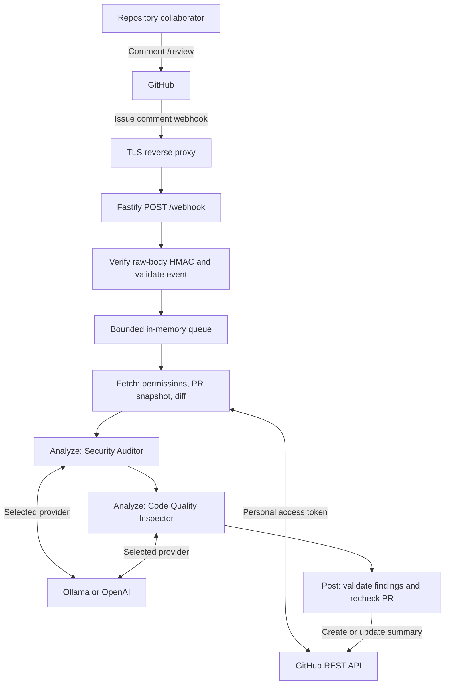

# Architecture

`mastra-pr-reviewer` runs as a single Node.js process. Fastify accepts signed GitHub webhooks, an in-memory queue schedules reviews, and a Mastra workflow coordinates fetching a PR diff, running two agents, and posting a summary. GitHub stores the resulting comment; the application has no database or durable job storage.

## System overview



The webhook handler acknowledges accepted work with HTTP `202` without waiting for a review. Authorization against GitHub and draft checks happen asynchronously in the workflow. A queued response therefore confirms admission, not permission or successful completion.

## Components and ownership

| Module | Responsibility |
| --- | --- |
| [`src/server.ts`](../src/server.ts) | HTTP routes, raw request bodies, event filtering, queue admission, deduplication, deadlines, and shutdown |
| [`src/utils/config.ts`](../src/utils/config.ts) | Zod validation of environment variables and resource limits |
| [`src/utils/verifySignature.ts`](../src/utils/verifySignature.ts) | HMAC SHA-256 verification using constant-time digest comparison |
| [`src/utils/github.ts`](../src/utils/github.ts) | Authenticated Octokit requests, collaborator permissions, PR snapshots, file pagination, and summary updates |
| [`src/utils/diff.ts`](../src/utils/diff.ts) | Unified-diff annotation, ignored-file filtering, and bounded diff preparation |
| [`src/agents/index.ts`](../src/agents/index.ts) | Provider loading, agent construction, generation adapters, and output parsing |
| [`src/agents/security.ts`](../src/agents/security.ts) | Shared review instructions and the Security Auditor |
| [`src/agents/quality.ts`](../src/agents/quality.ts) | Code Quality Inspector instructions |
| [`src/workflows/prReview.ts`](../src/workflows/prReview.ts) | Mastra Fetch → Analyze → Post workflow, finding validation, and summary rendering |
| [`src/types/index.ts`](../src/types/index.ts) | Shared schemas, service interfaces, review outcomes, and summary marker |

The `GitHubClient` and `ReviewAgent` interfaces allow tests to inject fakes while exercising the real workflow. `buildServer()` also accepts an injected runner for webhook and queue tests.

## Request lifecycle

### 1. Authenticate and filter the webhook

Fastify buffers the request body with a 1 MiB limit. The `/webhook` handler verifies `X-Hub-Signature-256` against those exact bytes before parsing JSON. Missing or invalid signatures receive `401`; signed malformed JSON receives `400`; signed requests with an unsupported content type receive `415`.

A signed `ping` receives a `pong` response. Review admission requires all of the following:

- The event is `issue_comment` with action `created`.
- The issue payload identifies a pull request.
- The comment author has GitHub user type `User`, and the sender matches that author.
- The entire comment is `/review`, allowing surrounding whitespace.
- The repository is in `GITHUB_REPOSITORIES`.
- A delivery ID is present and passes the configured format check.

Other events and nonmatching comments receive `202` with an ignored status. Edited comments do not trigger reviews.

### 2. Admit work to the queue

A `ReviewJob` contains only the owner, repository, PR number, requesting user, and delivery ID. Full webhook bodies are not retained in the queue.

The process maintains three in-memory structures:

| Structure | Purpose and lifetime |
| --- | --- |
| Job array | FIFO work awaiting execution |
| Pending PR set | Coalesces requests for the same repository and PR while queued or active |
| Delivery map | Suppresses repeated delivery IDs; at most 1,000 entries, expiring after 24 hours when subsequent commands are admitted |

`MAX_QUEUE_SIZE` limits active plus queued PRs. Saturation returns `503` with `Retry-After: 30`. Duplicate deliveries or requests for a pending PR receive `202` with a duplicate status. Coalesced requests do not schedule an additional run after the current review.

One drain loop processes jobs sequentially. Each active job gets an `AbortController` and a `REVIEW_TIMEOUT_MS` timer; time spent waiting in the queue does not count against that timer. The signal propagates through GitHub requests and agent generation. Cancellation is cooperative rather than a separate worker process being forcibly terminated.

### 3. Fetch and prepare context

The workflow's Fetch step:

1. Checks the requesting user's live collaborator permission. Only `write`, `maintain`, and `admin` qualify.
2. Fetches the PR and skips drafts or closed PRs.
3. Records the head SHA, base SHA, title, and total changed-file count.
4. Retrieves a bounded window of changed files and patches.
5. Fetches the PR again and skips the review if its head or base SHA changed during retrieval.
6. Filters and annotates patches, then applies file-count and character budgets.

File retrieval uses 100-file API pages. Its page limit is `ceil(min(600, MAX_FILES × 3) / 100)`. This allows extra candidates when early files are ignored, while bounding how much source is fetched.

Diff preparation skips common lockfiles, generated/binary assets, and files without patches. It labels context and additions with `new:N`, and deletions with `old:N`. Limits apply to the annotated content: `MAX_FILE_CHARS` per patch, `MAX_DIFF_CHARS` for the assembled diff, and `MAX_FILES` included files. Oversized patches are clipped at whole lines.

The prepared context records included, omitted, and truncated file counts. Omitted files include changes outside the fetched window. A PR with no reviewable patches is skipped without invoking either agent or posting a comment.

### 4. Analyze with two agents

The Analyze step constructs the two agents using one selected provider model and runs them sequentially:

| Agent | Focus |
| --- | --- |
| Security Auditor | Exploitable authorization, injection, secret exposure, input handling, cryptography, and related security changes |
| Code Quality Inspector | Correctness, edge cases, resource leaks, concurrency, error handling, and significant maintainability issues |

Both agents receive the PR title, reviewed head SHA, and prepared diff as untrusted JSON data. They have no tools. Instructions require concrete issues introduced by the changes and exclude cosmetic suggestions and speculative problems.

Each agent returns a JSON object containing up to ten findings. Findings have a `high` or `medium` severity, exact file path, nullable new-line number, title, explanation, and suggested fix. The application parses the response and validates it with Zod; a single surrounding JSON code fence is tolerated.

An individual agent error or invalid response marks that check as failed and allows the other check to run. The summary explicitly identifies incomplete checks, including when both checks fail. Cancellation aborts the workflow instead of producing a partial summary. Errors during provider or agent initialization also fail the job before a summary is posted.

### 5. Validate and post the result

The Post step checks that the PR remains open, non-draft, and on the recorded head and base SHAs. Changed PRs produce a skipped outcome and no comment update.

Summary rendering:

- Rejects findings for files absent from the supplied diff or numbered lines absent from that file's annotated new lines. A null line is permitted for a reviewed file.
- Deduplicates findings by file, line, and normalized title, then places high-severity findings first.
- Escapes generated HTML and Markdown syntax and interrupts mentions.
- Reports the reviewed head SHA, provider, coverage counts, and failed checks.
- Limits rendered finding content to leave room below GitHub's comment size limit.

The GitHub client retrieves the token account's user ID and searches paginated PR issue comments for both that author ID and the marker:

```text
<!-- mastra-pr-reviewer:summary:v1 -->
```

It updates the first matching comment or creates a new one. It does not update another account's marked comment. Changing the token account can therefore create a second summary.

The final PR check and comment write are separate API operations. A push can still race the write; the recorded head SHA makes the reviewed revision explicit.

## Provider boundary

`LLM_PROVIDER` selects `ollama` or `openai` at startup. Only the selected adapter is dynamically imported when agents are constructed.

| Provider | Adapter | Mastra generation method | Configuration |
| --- | --- | --- | --- |
| Ollama | `ollama-ai-provider` | `generateLegacy()`, for its AI SDK v1 model adapter | `OLLAMA_BASE_URL`, `OLLAMA_MODEL` |
| OpenAI | `@ai-sdk/openai` | `generate()` | `OPENAI_API_KEY`, `OPENAI_MODEL` |

Both paths allow one generation step, disable generation retries, share the job's abort signal, and apply `MAX_OUTPUT_TOKENS`. Provider changes require a process restart.

The selected endpoint receives the title and supplied diff. The GitHub token is used by Octokit and is not included in agent prompts or exposed through tools. Both adapters currently run inside the same process; they are not separate security sandboxes.

## Security boundaries

Webhook authenticity, repository admission, and user authorization are separate checks. A valid signature alone does not authorize a review: the allowlist and live collaborator permission check also apply.

Repository source, PR titles, filenames, and model output remain untrusted. Prompt instructions, tool-free agents, schema validation, location filtering, and output escaping reduce the effects of malicious content. They do not establish that a model's finding is correct or eliminate prompt injection risk.

The application does not clone repositories or execute submitted source. Server logs record delivery IDs and sanitized outcomes. A `ReviewFailure` retains only the operation stage, valid HTTP status, and an allowlisted error code; it does not retain the original error or cause. Job-local state preserves this diagnostic across Mastra step-error serialization. Summary posting distinguishes identity lookup, comment search, and comment write failures. Partial agent failures produce diagnostic warnings as well as the incomplete summary. Detailed upstream errors and framework logging are suppressed because they can contain credentials or source content. Configuration errors report field names without echoing environment values.

## Runtime and deployment

The application uses TypeScript compiled for Node.js 22.13 or newer. Configuration is validated before the server starts. Fastify exposes `POST /webhook` and `GET /health`; health checks confirm HTTP liveness only.

The workflow and GitHub modules load lazily on the first admitted job. The runner and GitHub client are reused, while each job creates its own workflow instance, execution run, signal, and agent instances. Workflow snapshots are not persisted. Imported modules remain loaded after the first review.

The idle RSS target is below 150 MB, including idle after a review. Sequential execution, bounded input, lazy imports, and the absence of a storage service support that target, but it remains unverified. Ollama model-server memory is separate from reviewer memory and normally requires a larger machine.

The multi-stage Docker build produces a runtime image with production dependencies. `npm run build` uses `tsconfig.build.json` to emit JavaScript without full type checking, dependency type resolution, or declaration generation, reducing compilation memory on a small VPS. All application source files are included explicitly by the inherited file patterns; test files are excluded. Full application and test type checking remains a separate CI step through `npm run typecheck`. CI builds with a 128 MB Node heap cap. The build's memory usage and the service's runtime memory usage are separate; Compose's service memory limit is not a build-time heap setting.

Compose runs one unprivileged container with a read-only filesystem, dropped capabilities, a temporary `/tmp`, a 256 MB memory allowance, and a loopback-only host port. A TLS reverse proxy must provide public ingress. Ollama is an external service and is not started by Compose.

SIGINT or SIGTERM closes the server, aborts active work, and discards queued jobs. Run one replica: queue state, deduplication, and summary creation are not coordinated across processes.

## Failure and recovery behavior

| Condition | Result | Recovery |
| --- | --- | --- |
| Invalid signature or request | HTTP rejection before queue admission | Correct webhook configuration or payload |
| Full queue | `503` response | Redeliver later or issue a new command |
| Insufficient permission, draft, closed PR, or no reviewable diff | Skipped outcome logged; no summary update | Resolve the condition and comment `/review` again |
| Head or base changes during review | Result discarded | Comment `/review` on the desired revision |
| Individual agent failure | Explicitly incomplete summary, if posting succeeds | Issue a new command |
| GitHub error, initialization failure, or cancellation | Job failure logged; delivery ID removed from deduplication cache | Redeliver or issue a new command |
| Process restart | Queued jobs and delivery history lost | Reissue pending review requests |

There is no durable retry scheduler or exactly-once guarantee. Delivery retention is bounded, and successful acceptance does not guarantee a posted result. An incomplete summary counts as a completed job, so repeating the same delivery ID is deduplicated; use a new `/review` comment to retry those checks.

## Validation status

The repository contains tests for signature verification, configuration, diff limits, agent output parsing, workflow decisions, webhook filtering, queue behavior, and shutdown. Workflow tests inject GitHub and agent fakes; webhook tests use Fastify injection. GitHub client tests exercise the real Octokit client with its HTTP transport mocked, checking permission failures, bounded pagination, cancellation, and comment ownership. Queue tests use a fake clock to verify the review deadline without waiting in real time. TypeScript validation includes the test files; production builds exclude them.

The expanded suite passes 59 tests against the installed dependencies, including pinned Mastra 1.82 and Fastify integration tests. Full type checking passes. The revised JavaScript build succeeds locally with a 128 MB Node heap cap, and the emitted application passes a smoke test covering health, a signed webhook, workflow execution with fake services, and summary generation. The full Docker image, live providers, and the idle-memory target require separate verification. See the [README](../README.md) for setup and validation commands.
